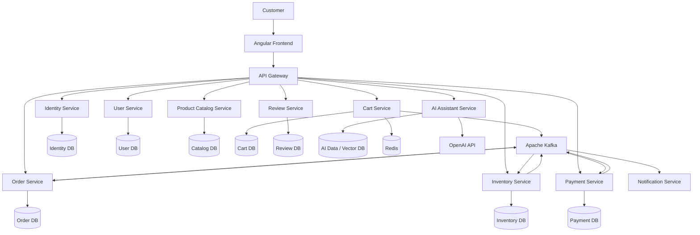

# SmartCart AI — System Architecture

## 1. Architecture Overview

SmartCart AI uses independently deployable microservices.

The Angular frontend communicates with backend services through the API Gateway.

## 2. High-Level Architecture



## 3. Communication Strategy

### Synchronous communication

REST APIs will be used when an immediate response is required.

Examples:
- Frontend retrieves product information.
- Customer views their cart.
- Customer requests order details.

### Asynchronous communication

Kafka events will be used when services need to communicate without waiting for an immediate response.

Examples:
- OrderPlaced
- PaymentCompleted
- PaymentFailed
- InventoryReserved
- OrderCancelled

## 4. Database Ownership

Each business service owns its data.

A service must never directly query another service's database.

For local development, we may use one PostgreSQL container with separate databases for individual services.

## 5. Resilience and Distributed Transactions

We will implement these concepts progressively:

- Saga pattern for distributed business workflows.
- Transactional Outbox for reliable event publishing.
- Idempotency for duplicate request protection.
- Retry and timeout policies.
- Circuit breakers.
- Dead Letter Queues (DLQ).

## 6. AI Assistant

The AI Assistant Service will support:

- Natural-language product search.
- Product recommendations.
- Retrieval-Augmented Generation (RAG).
- Vector search using pgvector.
- OpenAI integration.

## 7. Deployment Strategy

Each microservice will have its own build and deployment configuration.

Docker Compose will orchestrate the local development environment.

Kubernetes and cloud deployment will be explored in later phases.
```
